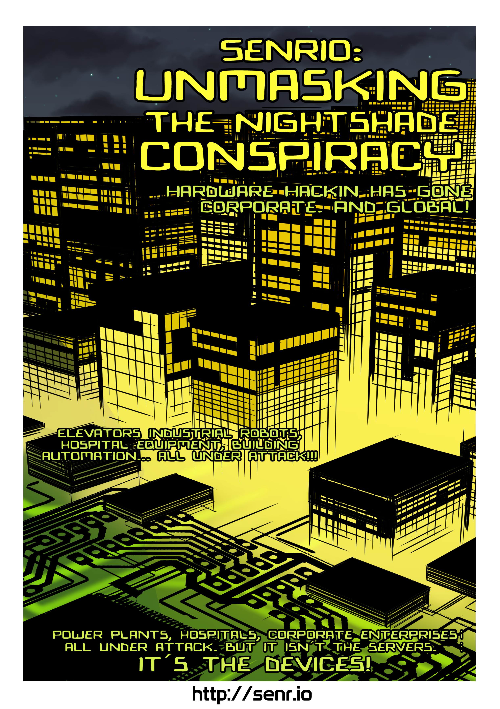

# Device "Hacking" Comic
This is a backup for a "Device &amp; Infrastructure Hacking" comic that was previously available at https://senr.io/comic from the year 2015 to about 2022.
Recent events like the "[EU Blood Bank Hacks](https://www.cnbc.com/2026/11/04/blood-bank-fridges-cyberattacks.html)", "[EU-wide Refrigeration hacks](https://x.com/nexta_tv/status/2117340970228609223)", and "[nationwide U.S. FAA grounding](https://en.wikipedia.org/wiki/2026_FAA_communication_outage)" mirror some of the plotpoints of this comic, so I thought it would be nice to archive it here (even though it has been apparently uploaded to [sites like Scribd](https://www.scribd.com/document/887706108/Senrio-IoT-Hacking-Comic), and [surprisingly] quoted in other presentations and books).

Unfortunately, the Internet Archive, only partially archived this comic at URLs like the following: https://web.archive.org/web/20201108100115/https://senr.io/comic#page/1
So I am archiving it here.

# The Full PDF:
The [full PDF](Senrio_IoT_Hacking_Comic.pdf) is here, but individual pages of [varying sizes are here](comic-pages/).

 
